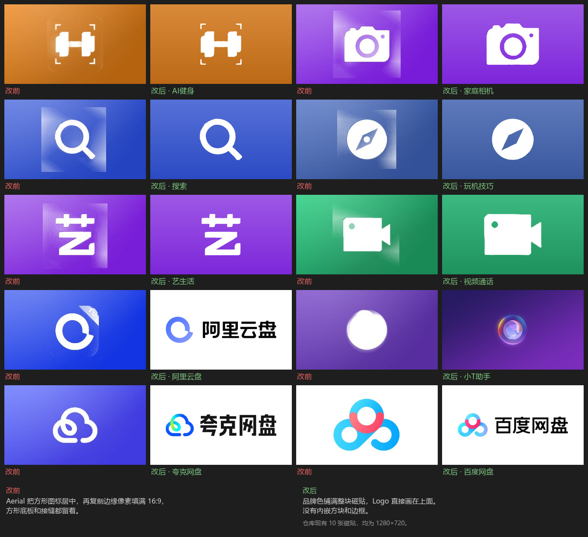
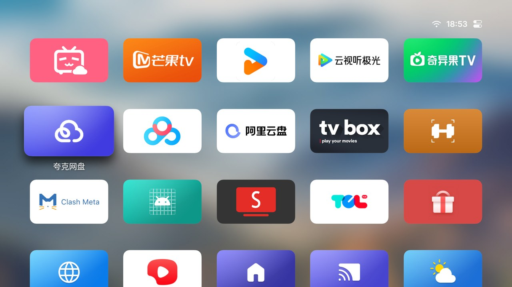

# aerial-tcl-icons

给 [Aerial](https://github.com/pengchujin/aerial-tv)（开源电视桌面）手工排版的一批 16:9 磁贴图，用于 TCL 电视上那些「方形图标被拉成宽条」的 App。



## 问题是什么

Aerial 的磁贴固定是 16:9（源码里 `tileH = tileW * 9 / 16`）。图标有三个来源，优先级从高到低：

1. 你在手机页面手动上传的图
2. Aerial 官方图库（`https://aerial.qust.me/icons/`，128 张手工图）
3. **App 自带的图标现画**

走第三条时，Aerial 把方形图标居中放好，再把左右两侧的边缘像素向外复制来填满宽磁贴。结果就是一个方形色块「卡」在长方形中间，边缘还有一圈可见的接缝。TCL 固件自带的那些 App（家庭相机、搜索、玩机技巧、艺生活、视频通话……）基本都是这种图标，官方图库也没收录。

这批图就是把这些磁贴重做成 bilibili、芒果TV 那种样子：**品牌色铺满整块磁贴，Logo 直接画在上面**，没有内嵌方块、没有卡片、没有边框。



## 里面有什么

```
tiles/          1280×720 的成品磁贴，文件名就是包名
manifest.json   包名 → 文件名的对照表
assets/         阿里云盘那张用的官方组合标（存档）
docs/           改前改后对比图、电视实拍
```

对应关系：

| App | 包名 | 文件 |
|---|---|---|
| AI健身 | `com.health.aisportcoach` | `tiles/com.health.aisportcoach.png` |
| 家庭相机 | `com.tcl.camera` | `tiles/com.tcl.camera.png` |
| 搜索 | `com.tcl.wholenetsearch` | `tiles/com.tcl.wholenetsearch.png` |
| 玩机技巧 | `com.tcl.playskill` | `tiles/com.tcl.playskill.png` |
| 艺生活 | `com.tcl.appreciate.art` | `tiles/com.tcl.appreciate.art.png` |
| 视频通话 | `com.tcl.videocall` | `tiles/com.tcl.videocall.png` |
| 阿里云盘 | `tv.huan.aliyunpan` | `tiles/tv.huan.aliyunpan.png` |

## 怎么用

Aerial 自带一个手机页面，可以直接给单个 App 换图，不需要电脑、不需要命令行、也不需要 adb。

1. 电视上按 **返回键**，打开控制中心，点 **个性化**
2. 页面上会显示一行地址，形如 `http://192.168.x.x:8790/abc12345/`
   （`8790` 是端口，后面那串 8 位是令牌，每台电视不一样）
3. 让手机或电脑连到 **和电视同一个 Wi-Fi**，在浏览器里打开这个地址
4. 找到要改的 App，上传 `tiles/` 里对应的那张图
5. 电视上的磁贴会立刻变成新图，不用重启

几点说明：

- **直接传原图就行**，不用自己裁剪。Aerial 会自动把图裁成 16:9、存成 1280×720。
- 这个地址**长期有效**（令牌存在电视上，重启也不变），可以存成书签。
- 一次只能改一个 App，换几个就重复第 4 步。
- 页面上还能顺便改壁纸、屏保、焦点样式、天气城市，都是同一套操作。

## 还原

在同一个页面里，把该 App 的图标来源选回 **App 自带**，就会退回 Aerial 自己画的那版（也就是「改前」的样子）。

## 已知没做的

| App | 原因 |
|---|---|
| 有线频道 `com.tcl.tliveplay` | 图标本身是一整个 3D 渲染（卫星锅 + 蓝色「广电授权」缎带），没有平面的 Logo 可以分离出来 |
| JiqiMao `com.tcl.rewalleve` | 细线条网格图案，原图本来就是满幅铺开，不算「方块卡在中间」 |
| 智能相册 `com.tcl.tvsmartalbum` | 试过重做，但原图标本身更好看，保持原样 |

## 版权与商标

`tiles/` 和 `assets/` 里的图形是各家 App 的商标与著作权作品，版权归各自所有者。这里只是把本机已安装 App 的图标按另一种版式重排，供个人在自家电视上使用，**不构成任何授权**。如果你要商用或再分发，请自行取得权利人许可。

本项目与 Aerial、阿里巴巴、TCL 均无关联。详见 [NOTICE](NOTICE)。
